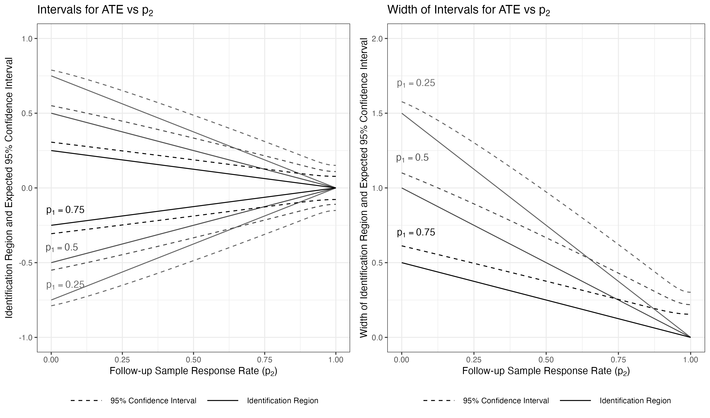
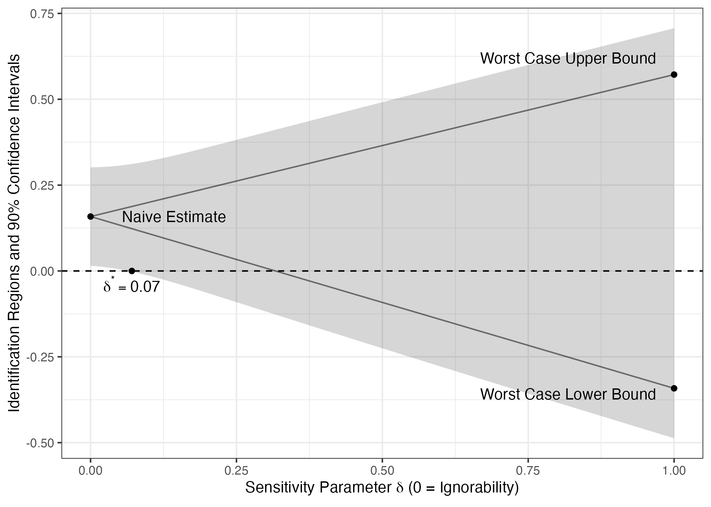

# Active Maintenance Report: coppock_etal_2017

2026-08-01

- [Summary](#summary)
  - [Does the deposited archive run?](#does-the-deposited-archive-run)
  - [Does the maintained rewrite reproduce the
    paper?](#does-the-maintained-rewrite-reproduce-the-paper)
- [Paper overview](#paper-overview)
- [Original archive reproducibility](#original-archive-reproducibility)
  - [The two packages](#the-two-packages)
  - [The stale object name](#the-stale-object-name)
- [Errata](#errata)
- [The extraction and the two
  instruments](#the-extraction-and-the-two-instruments)
- [Number-by-number comparison](#number-by-number-comparison)
- [Maintained rewrite](#maintained-rewrite)
  - [Deprecated patterns replaced](#deprecated-patterns-replaced)
- [Figures](#figures)
- [Maintained rewrite verification](#maintained-rewrite-verification)
- [R environment](#r-environment)

*Drafted by Claude Opus 5 under the supervision of Alex Coppock.*

This repository holds the actively maintained replication code for
Coppock, Gerber, Green and Kern (2017), together with the
reproducibility report that documents what the original archive did and
did not do. It is part of a program applying the maintenance proposal in
Peer, Orr and Coppock (2021, *PS: Political Science & Politics*, doi
[10.1017/S1049096521000366](https://doi.org/10.1017/S1049096521000366))
to a set of published archives.

|  |  |
|----|----|
| Article | [10.1017/pan.2016.6](https://doi.org/10.1017/pan.2016.6) |
| Replication archive | [10.7910/DVN/AQB4MP](https://doi.org/10.7910/DVN/AQB4MP) |
| Preanalysis plan | [osf.io/wkj8v](https://osf.io/wkj8v) |

**The data are not redistributed here.** The deposit is 231 KB across
seven files and lives at Harvard Dataverse, which is the only copy this
repository points at. `download_original.R` fetches it and verifies
every file; `original_manifest.csv` pins the file identifiers, sizes and
checksums, so the exact bytes this code was written against are recorded
in version control even though the bytes themselves are not.

**Repository layout.** `maintained/` is the maintained rewrite: one
script per published table or figure, writing to `output/`, which is
committed so a reader can compare a fresh run against it without
downloading anything. `ground_truth/` ties every published number to the
code that produces it: `published_claims.csv` is the hand extraction of
the article, `build_ground_truth.R` generates the comparison and runs
the coverage gate, and `coppock_etal_2017_ground_truth.csv` is what it
writes. `original/` is created by the download script and is
deliberately absent from the repository. This file is the
reproducibility report, also available as a PDF in `report/`.

**License.** CC0 1.0 Universal, matching the terms of the deposit this
repository maintains. See `LICENSE`.

**To reproduce.** Clone or download the repository, open
`coppock_etal_2017.Rproj`, and run:

``` r
source("run_all.R")
```

That fetches the deposit, verifies its seven files, installs the
`attrition` package from the deposited source tarball if it is not
already present, and produces every table and figure into
`maintained/output/`. Required packages: tidyverse, estimatr,
modelsummary, knitr, kableExtra, gridExtra, here, and `attrition`, which
`install_attrition.R` handles. Paths resolve through `here`, so nothing
depends on the working directory. The full run takes about seven
seconds. A successful run overwrites `maintained/output/`, which is
committed: **`git diff` on that folder is the reproduction check.** The
three PDF figures differ on every run because a PDF records the time it
was written; the CSV, TeX and PNG output comes back byte-identical.

# Summary

Two questions, answered before the detail.

## Does the deposited archive run?

Not without intervention, and the obstacle is a bug in the deposit
rather than anything that has aged. `experimental_analysis_main_text.R`
prints Tables 1, 2 and 3 and then stops at a line that subtracts rows
from an object called `mturk_results`, which the script never creates.
The object it means is `table_3`, assembled four lines earlier under a
different name. Everything after that line, which is the 65 percent
confidence interval reduction the results section quotes and the entire
sensitivity analysis behind Figure 2, is unreachable. That leaves 3
recorded claims with no archive value at all, all of them numbers the
article prints: the reduction in interval width, the sensitivity
parameter as Section 4.3 states it, and the same parameter as Figure 2
prints it on its face.

The other two scripts run. `simulation_analysis.R` produces Figure 1 and
Appendix Figure 1 with two deprecation warnings and no errors.
`experimental_analysis_appendix.R` runs and reproduces Appendix Table 1
exactly, but only against the `commarobust` package as deposited. The
current version of `commarobust` on GitHub also calls itself 0.1.0 and
exports nothing at all: it has been reduced to a message telling the
user to install `estimatr` instead. A reader who follows the archive’s
own README, which recommends `devtools::install_github()` over the
bundled tarball, gets a package that fails on the first line that uses
it, and `packageVersion()` reports the same number either way.

The remaining 128 claims the archive can be compared on all reproduce,
including every cell of all five published tables.

## Does the maintained rewrite reproduce the paper?

Yes, without exception. Of the 171 recorded claims, 158 carry a
published number and all 158 match it to the precision the page prints;
0 differ. The remaining 13 are claims about shape rather than value, and
all 13 hold. The three the archive cannot reach are among the matches:
replacing the stale object name gives a 65.0 percent reduction in
confidence interval width where the paper says 65 percent, and the
sensitivity analysis gives a $\delta^*$ of 0.0707 where the paper and
Figure 2 both say 0.07.

No sentence in the article is contradicted by the data behind it, so
this repository carries no errata document.

# Paper overview

**Citation**: Coppock, A., Gerber, A. S., Green, D. P. and Kern, H. L.
(2017). “Combining double sampling and bounds to address nonignorable
missing outcomes in randomized experiments.” *Political Analysis*,
25(2), 188-206. DOI: 10.1017/pan.2016.6

**Summary**: Missing outcomes break the guarantee randomization
provides, and the usual repairs assume that missingness is ignorable.
The paper proposes an alternative that does not: combine a double
sampling design, in which a random subset of the initial nonrespondents
is pursued with a larger incentive, with nonparametric worst-case bounds
on the outcomes still missing after that second effort. It derives the
bounds estimator under double sampling, gives analytic variances and
confidence intervals, adds poststratification for covariate adjustment,
and adds a sensitivity analysis indexed by the fraction $\delta$ of
remaining nonrespondents for whom ignorability fails. Monte Carlo
simulations show how the identification region and the confidence
interval respond to the two response rates. The application is a
two-wave Mechanical Turk replication of Levendusky and Malhotra (2016)
in which 1,980 subjects read either a polarized or a moderate news
story, 1,444 responded in the initial Wave 2 sample, and 50
nonrespondents per arm were offered four times the original incentive,
of whom 72 complied. Worst-case bounds from the initial sample alone are
$(-1.54, 1.71)$ and say nothing. Double sampling with poststratification
narrows the associated confidence interval from 3.50 to 1.23, a 65
percent reduction, while the sensitivity analysis shows the significant
naive estimate collapses once ignorability fails for even 7 percent of
the remaining nonrespondents.

# Original archive reproducibility

| Script | Status on current R | Resolution |
|:---|:---|:---|
| experimental_analysis_main_text.R | Prints Tables 1, 2 and 3, then stops: object ‘mturk_results’ not found | The object meant is table_3, built four lines above under another name |
| experimental_analysis_appendix.R | Runs against the deposited commarobust; fails against the current one | install.packages(‘original/commarobust_0.1.0.tar.gz’, repos = NULL, type = ‘source’) |
| simulation_analysis.R | Runs; two deprecation warnings | guide = FALSE becomes guide = ‘none’; %+% becomes + |

Original archive reproducibility, checked against R 4.6.0 on 1 August
2026.

The deposit is unusually well prepared in one respect and unusually
exposed in another. It bundles the source tarballs of both packages the
analysis depends on, `attrition` and `commarobust`, neither of which has
ever been on CRAN. That is the right instinct, and it is what makes the
appendix script reproducible today. The README then undercuts it: it
recommends installing from GitHub instead, calling that route “easy,”
and offers the tarballs only “in the interest of full replicability.”
Ten years on, the easy route is the broken one.

## The two packages

`attrition` implements the paper’s method and is still on GitHub. The
deposited version is 0.0.0.9000 and the current one is 1.0.0, and the
two no longer agree everywhere. 1.0.0 fixed the Imbens-Manski critical
value, which had been found by minimising an absolute value over a fixed
interval that only covers alpha near 0.05, so the interval bounds move
by about 2e-09 relative here and would move much more at another
significance level. Every point estimate is unchanged. 1.0.0 also
renamed the six quantities its estimators return, onto broom’s names,
and reports the uncertainty as a standard error where 0.0.0.9000
reported a variance. The maintained rewrite is written against the
current package and `install_attrition.R` halts if an older one is
installed, since the old names would otherwise fill these tables with
`NA` rather than fail. The deposited tarball is still what the scripts
in `original/` are written against, and it still runs them;
`install_attrition.R` installs it when `attrition` is absent, because
the tarball’s checksum is pinned in `original_manifest.csv` and a GitHub
repository’s contents are not.

`commarobust` is a different case. It was the author’s prototype for
robust standard errors around `lm()`, and it was superseded by
`estimatr`, whose `lm_robust()` defaults to the same HC2 estimator. The
current GitHub `commarobust` has been emptied out to a startup message
pointing at `estimatr`, and it exports no functions. It nevertheless
still calls itself version 0.1.0, exactly like the deposited tarball,
which exports six. Two packages with the same name and the same version
number differ in whether the archive runs, and nothing in
`sessionInfo()` would tell a reader which one they have.

## The stale object name

The main text script builds Table 3 and then reaches for it under a name
it does not have:

``` r
table_3 <- cbind(no_ds = cis_1, ds = cis_2, ds_ps = cis_3)
# ... four lines of row labels and a print ...
widths <- mturk_results[2,] - mturk_results[1,]
(widths[1] - widths[3]) / widths[1]
```

`mturk_results` is never assigned anywhere in the archive. The name
presumably survived an interactive session in which the object had been
called that, and the rename was not carried through before the file was
deposited. This is the class of defect that only a clean-session run
finds: in the author’s own session the old object was still in the
workspace, so the script worked.

The cost is not cosmetic. The line that fails computes the 65 percent
reduction in confidence interval width, which is the sentence the
results section builds toward, and everything below it, including the
entire sensitivity analysis and Figure 2, never executes. Both values
are correct once the name is fixed, so the archive contains a correct
analysis that it cannot run.

# Errata

The maintained rewrite makes one correction to the archive’s code:
`mturk_results` becomes the object that was meant. Nothing else in the
estimator, the specification or the sample is changed.

| Claim | Published | Archive | Rewrite |
|:---|:---|:---|:---|
| Section 4.2 reduction in 95% CI width | 65 percent | not computed, script stops | 0.6503 |
| Section 4.3 sensitivity parameter | 0.07 | not computed, script stops | 0.0707 |
| Figure 2 annotation | 0.07 | not computed, script stops | 0.0707 |

The published claims the deposited script cannot reach, and what the
rewrite produces.

No published value changes. The correction recovers numbers the archive
was unable to produce; all of them agree with the article. That is a
correction to the deposited code, which is what this section is for. It
is not an erratum in the article, and there are none: every number the
article prints is reproduced here, and every claim it makes about shape
holds.

# The extraction and the two instruments

Two files stand between the article and this pipeline, and they are
deliberately separate.

`ground_truth/published_claims.csv` is the **extraction**: every numeric
token in the article and the online appendix, read out by hand and
classified. It carries 212 rows. Citation years, equation numbers,
footnote markers, section cross-references and page numbers are excluded
as typography rather than claims; everything else is here, including
numbers spelled out in words (“three scenarios”, “two decades”, “the
four policy questions”) that no token scan finds. `value_paper` is the
string the page prints, with its digits intact, and `digits` records
that precision for each claim separately, because the appendix
regression table prints one R-squared at three decimals and its
neighbour at four.

| Claim type   | Needs a claim block | Rows |
|:-------------|:--------------------|-----:|
| definitional | no                  |   26 |
| definitional | yes                 |   16 |
| descriptive  | yes                 |   13 |
| pipeline     | yes                 |  138 |
| structural   | yes                 |    4 |
| transcribed  | no                  |   15 |

The extraction, by claim type.

A block is required for 171 of those rows. The 41 that do not need one
are quantities the deposit was never going to record and that no code
can therefore check: the \$1.00 and \$4.00 payments, the ten days
between waves, the seven-point item scales, and the percentages inside
the treatment articles themselves, which are quoted from the source
study. They are verified against the article’s own methods section and
at the point of use in the scripts, and they are named here so that a
reader can see the boundary rather than infer it. The simulation’s
outcome means and variances are in the same class: they are inputs to
`attrition:::ds_manski_cis_2s()` that no output file carries, and they
sit beside the call in `figure_1_simulation.R`.

`maintained/in_text_claims.R` is the **second instrument**. It reads
only `maintained/output/`, never the ground truth, and it recomputes
each claimed number by its own path: the prose figures of Section 4.2
are derived there from `table_3_bounds_main.csv` and
`table_a1_mipo_effects.csv` rather than read out of
`text_section_4_claims.csv`, which is the file the ground truth reads.
It prints one line per claim, and `ground_truth/build_ground_truth.R`
runs it as a program, in its own environment, and asserts three things:
that the number of claims printed equals the number the extraction
requires, that the two sets of identifiers are equal in both directions,
and that every printed value equals the ground truth’s own value
rendered at the same precision.

Two of the article’s claims are checkable only because a second quantity
can be recovered from the tables the article prints. Section 4.2 says
missing outcomes are replaced with the lowest possible value of 0 and
the highest of 6. Neither limit appears in any output file, but with the
response rates of Table 1 and the initial-responder means of Table 2,
the worst-case low and high estimates of Table 3 are two linear
equations in exactly those two limits, and solving them returns 0 and 6.

Coverage of the published floats is complete for the tables: 15 of 15
cells in Table 1, 12 of 12 in Table 2, 18 of 18 in Table 3, 32 of 32 in
Appendix Table 1 and 36 of 36 in Appendix Table 2, or 113 published
cells with 113 rows. The three figures print no estimates except the
$\delta^* = 0.07$ that Figure 2 carries on its face, which is covered.
What the figures do assert is shape, and those assertions are covered by
claims with computed truth values rather than by cells: that the
identification region collapses to a point when everyone responds to the
follow-up, that at a follow-up response rate of zero its width returns
to the worst-case width of $2(1 - p_1)$, that it narrows as the initial
response rate rises, and that raising the sample size a hundredfold
shrinks the confidence interval while leaving the identification region
unchanged to the last decimal.

# Number-by-number comparison

| Location | Claim | Paper | Archive | Match |
|:---|:---|:---|:---|:---|
| appendix_section_1_p2 | appx_n_large | 80000 |  |  |
| appendix_section_1_p2 | appx_n_small | 800 |  |  |
| appendix_section_1_p2 | appx_n2_large | 5000 |  |  |
| appendix_section_1_p2 | appx_n2_small | 50 |  |  |
| appendix_section_1_p2 | appx_size_factor | 100 |  |  |
| appendix_section_1_p2 | appx_two_scenarios | 2 |  |  |
| appendix_section_2_p3 | appx_effect_diminished |  |  |  |
| appendix_section_2_p3 | appx_extremity_negligible |  |  |  |
| appendix_section_2_p3 | appx_wave1_effect | 0.468 |  |  |
| appendix_section_2_p3 | appx_wave1_effect_strong |  |  |  |
| appendix_section_2_p3 | appx_wave2_effect | 0.126 |  |  |
| appendix_section_3_p4 | appx_pairwise_columns | 6 |  |  |
| figure_1 | sim_p2_zero_is_wcb |  |  |  |
| figure_1 | sim_point_identified |  |  |  |
| figure_1 | sim_region_smaller_in_p1 |  |  |  |
| figure_1 | sim_width_shrinks_to_zero |  |  |  |
| figure_2 | fig2_delta_star | 0.07 |  | 0 |
| figure_a1 | appx_ci_shrinks_region_does_not |  |  |  |
| section_3_p11 | sim_n_followup | 50 |  |  |
| section_3_p11 | sim_n_total | 800 |  |  |
| section_3_p11 | sim_p1_max | 0.75 |  |  |
| section_3_p11 | sim_p1_min | 0.25 |  |  |
| section_3_p11 | sim_p2_max | 1 |  |  |
| section_3_p11 | sim_p2_min | 0 |  |  |
| section_3_p11 | sim_true_ate | 0 |  |  |
| section_3_p12 | sim_n_scenarios | 3 |  |  |
| section_3_p12 | sim_p1_scenario_high | 0.75 |  |  |
| section_3_p12 | sim_p1_scenario_low | 0.25 |  |  |
| section_3_p12 | sim_p1_scenario_mid | 0.50 |  |  |
| section_4.1_p14 | app_n_completed | 72 |  |  |
| section_4.1_p14 | app_n_invited | 100 |  |  |
| section_4.1_p14 | app_n_invited_per_arm | 50 |  |  |
| section_4.1_p14 | app_n_responded | 1444 |  |  |
| section_4.1_p14 | app_n_subjects | 1980 |  |  |
| section_4.2_p14 | app_outcome_max | 6 |  |  |
| section_4.2_p14 | app_outcome_min | 0 |  |  |
| section_4.2_p14 | txt_ci_width_ds_ps | 1.23 | 1.23 | 1 |
| section_4.2_p14 | txt_ci_width_no_ds | 3.50 | 3.50 | 1 |
| section_4.2_p14 | txt_ds_ps_ci_lower | -0.53 | -0.53 | 1 |
| section_4.2_p14 | txt_ds_ps_ci_upper | 0.70 | 0.70 | 1 |
| section_4.2_p14 | txt_ds_ps_wcb_high | 0.53 | 0.53 | 1 |
| section_4.2_p14 | txt_ds_ps_wcb_low | -0.34 | -0.34 | 1 |
| section_4.2_p14 | txt_ds_wcb_high | 0.57 | 0.57 | 1 |
| section_4.2_p14 | txt_ds_wcb_low | -0.34 | -0.34 | 1 |
| section_4.2_p14 | txt_naive_ate_coef | 0.126 | 0.126 | 1 |
| section_4.2_p14 | txt_naive_ate_pval | 0.057 | 0.057 | 1 |
| section_4.2_p14 | txt_naive_ate_se | 0.066 | 0.066 | 1 |
| section_4.2_p14 | txt_no_ds_ci_lower | -1.67 | -1.67 | 1 |
| section_4.2_p14 | txt_no_ds_ci_upper | 1.84 | 1.84 | 1 |
| section_4.2_p14 | txt_no_ds_wcb_high | 1.71 | 1.71 | 1 |
| section_4.2_p14 | txt_no_ds_wcb_low | -1.54 | -1.54 | 1 |
| section_4.2_p14 | txt_reduction_pct | 0.65 |  | 0 |
| section_4.3_p15 | app_naive_sig_10 |  |  |  |
| section_4.3_p15 | app_no_delta_star_05 |  |  |  |
| section_4.3_p15 | txt_delta_star | 0.07 |  | 0 |
| table_1 | t1_moderate_did_not_respond | 264 | 264 | 1 |
| table_1 | t1_moderate_invited | 50 | 50 | 1 |
| table_1 | t1_moderate_n_initial | 995 | 995 | 1 |
| table_1 | t1_moderate_responded | 731 | 731 | 1 |
| table_1 | t1_moderate_responded_to_invitation | 39 | 39 | 1 |
| table_1 | t1_polarized_did_not_respond | 272 | 272 | 1 |
| table_1 | t1_polarized_invited | 50 | 50 | 1 |
| table_1 | t1_polarized_n_initial | 985 | 985 | 1 |
| table_1 | t1_polarized_responded | 713 | 713 | 1 |
| table_1 | t1_polarized_responded_to_invitation | 33 | 33 | 1 |
| table_1 | t1_total_did_not_respond | 536 | 536 | 1 |
| table_1 | t1_total_invited | 100 | 100 | 1 |
| table_1 | t1_total_n_initial | 1980 | 1980 | 1 |
| table_1 | t1_total_responded | 1444 | 1444 | 1 |
| table_1 | t1_total_responded_to_invitation | 72 | 72 | 1 |
| table_2 | app_samples_similar |  |  |  |
| table_2 | t2_moderate_ds_mean | 3.583 | 3.583 | 1 |
| table_2 | t2_moderate_ds_n | 39 | 39 | 1 |
| table_2 | t2_moderate_ds_sd | 1.367 | 1.367 | 1 |
| table_2 | t2_moderate_ir_mean | 3.542 | 3.542 | 1 |
| table_2 | t2_moderate_ir_n | 731 | 731 | 1 |
| table_2 | t2_moderate_ir_sd | 1.243 | 1.243 | 1 |
| table_2 | t2_polarized_ds_mean | 3.826 | 3.826 | 1 |
| table_2 | t2_polarized_ds_n | 33 | 33 | 1 |
| table_2 | t2_polarized_ds_sd | 1.313 | 1.313 | 1 |
| table_2 | t2_polarized_ir_mean | 3.668 | 3.668 | 1 |
| table_2 | t2_polarized_ir_n | 713 | 713 | 1 |
| table_2 | t2_polarized_ir_sd | 1.270 | 1.270 | 1 |
| table_3 | app_ds_narrows |  |  |  |
| table_3 | app_wcb_uninformative |  |  |  |
| table_3 | t3_ds_ci_lower | -0.5283 | -0.5283 | 1 |
| table_3 | t3_ds_ci_upper | 0.7452 | 0.7452 | 1 |
| table_3 | t3_ds_ps_ci_lower | -0.5290 | -0.5290 | 1 |
| table_3 | t3_ds_ps_ci_upper | 0.6966 | 0.6966 | 1 |
| table_3 | t3_ds_ps_var_high | 0.0108 | 0.0108 | 1 |
| table_3 | t3_ds_ps_var_low | 0.0126 | 0.0126 | 1 |
| table_3 | t3_ds_ps_wcb_high | 0.5257 | 0.5257 | 1 |
| table_3 | t3_ds_ps_wcb_low | -0.3444 | -0.3444 | 1 |
| table_3 | t3_ds_var_high | 0.0111 | 0.0111 | 1 |
| table_3 | t3_ds_var_low | 0.0129 | 0.0129 | 1 |
| table_3 | t3_ds_wcb_high | 0.5718 | 0.5718 | 1 |
| table_3 | t3_ds_wcb_low | -0.3417 | -0.3417 | 1 |
| table_3 | t3_no_ds_ci_lower | -1.6691 | -1.6691 | 1 |
| table_3 | t3_no_ds_ci_upper | 1.8359 | 1.8359 | 1 |
| table_3 | t3_no_ds_var_high | 0.0059 | 0.0059 | 1 |
| table_3 | t3_no_ds_var_low | 0.0062 | 0.0062 | 1 |
| table_3 | t3_no_ds_wcb_high | 1.7097 | 1.7097 | 1 |
| table_3 | t3_no_ds_wcb_low | -1.5391 | -1.5391 | 1 |
| table_a1 | ta1_all_ex_wave1_n | 2156 | 2156 | 1 |
| table_a1 | ta1_all_ex_wave1_r2 | 0.001 | 0.001 | 1 |
| table_a1 | ta1_all_ex_wave2_n | 2156 | 2156 | 1 |
| table_a1 | ta1_all_ex_wave2_r2 | 0.0004 | 0.0004 | 1 |
| table_a1 | ta1_all_pp_wave1_n | 2156 | 2156 | 1 |
| table_a1 | ta1_all_pp_wave1_r2 | 0.024 | 0.024 | 1 |
| table_a1 | ta1_all_pp_wave2_n | 2156 | 2156 | 1 |
| table_a1 | ta1_all_pp_wave2_r2 | 0.002 | 0.002 | 1 |
| table_a1 | ta1_constant_ex_wave1_coef | 1.531 | 1.531 | 1 |
| table_a1 | ta1_constant_ex_wave1_se | 0.024 | 0.024 | 1 |
| table_a1 | ta1_constant_ex_wave2_coef | 1.617 | 1.617 | 1 |
| table_a1 | ta1_constant_ex_wave2_se | 0.024 | 0.024 | 1 |
| table_a1 | ta1_constant_pp_wave1_coef | 3.108 | 3.108 | 1 |
| table_a1 | ta1_constant_pp_wave1_se | 0.046 | 0.046 | 1 |
| table_a1 | ta1_constant_pp_wave2_coef | 3.542 | 3.542 | 1 |
| table_a1 | ta1_constant_pp_wave2_se | 0.046 | 0.046 | 1 |
| table_a1 | ta1_placebo_ex_wave1_coef | 0.019 | 0.019 | 1 |
| table_a1 | ta1_placebo_ex_wave1_se | 0.035 | 0.035 | 1 |
| table_a1 | ta1_placebo_ex_wave2_coef | -0.011 | -0.011 | 1 |
| table_a1 | ta1_placebo_ex_wave2_se | 0.034 | 0.034 | 1 |
| table_a1 | ta1_placebo_pp_wave1_coef | 0.352 | 0.352 | 1 |
| table_a1 | ta1_placebo_pp_wave1_se | 0.067 | 0.067 | 1 |
| table_a1 | ta1_placebo_pp_wave2_coef | 0.042 | 0.042 | 1 |
| table_a1 | ta1_placebo_pp_wave2_se | 0.066 | 0.066 | 1 |
| table_a1 | ta1_polarized_ex_wave1_coef | -0.031 | -0.031 | 1 |
| table_a1 | ta1_polarized_ex_wave1_se | 0.034 | 0.034 | 1 |
| table_a1 | ta1_polarized_ex_wave2_coef | -0.030 | -0.030 | 1 |
| table_a1 | ta1_polarized_ex_wave2_se | 0.034 | 0.034 | 1 |
| table_a1 | ta1_polarized_pp_wave1_coef | 0.468 | 0.468 | 1 |
| table_a1 | ta1_polarized_pp_wave1_se | 0.067 | 0.067 | 1 |
| table_a1 | ta1_polarized_pp_wave2_coef | 0.126 | 0.126 | 1 |
| table_a1 | ta1_polarized_pp_wave2_se | 0.066 | 0.066 | 1 |
| table_a2 | ta2_mod_vs_placebo_ex_ci_lower | -0.4778 | -0.4778 | 1 |
| table_a2 | ta2_mod_vs_placebo_ex_ci_upper | 0.5769 | 0.5769 | 1 |
| table_a2 | ta2_mod_vs_placebo_ex_var_high | 0.0067 | 0.0067 | 1 |
| table_a2 | ta2_mod_vs_placebo_ex_var_low | 0.0083 | 0.0083 | 1 |
| table_a2 | ta2_mod_vs_placebo_ex_wcb_high | 0.4426 | 0.4426 | 1 |
| table_a2 | ta2_mod_vs_placebo_ex_wcb_low | -0.3284 | -0.3284 | 1 |
| table_a2 | ta2_mod_vs_placebo_pp_ci_lower | -0.6119 | -0.6119 | 1 |
| table_a2 | ta2_mod_vs_placebo_pp_ci_upper | 0.5044 | 0.5044 | 1 |
| table_a2 | ta2_mod_vs_placebo_pp_var_high | 0.0114 | 0.0114 | 1 |
| table_a2 | ta2_mod_vs_placebo_pp_var_low | 0.0106 | 0.0106 | 1 |
| table_a2 | ta2_mod_vs_placebo_pp_wcb_high | 0.3286 | 0.3286 | 1 |
| table_a2 | ta2_mod_vs_placebo_pp_wcb_low | -0.4424 | -0.4424 | 1 |
| table_a2 | ta2_pol_vs_mod_ex_ci_lower | -0.6087 | -0.6087 | 1 |
| table_a2 | ta2_pol_vs_mod_ex_ci_upper | 0.6032 | 0.6032 | 1 |
| table_a2 | ta2_pol_vs_mod_ex_var_high | 0.0095 | 0.0095 | 1 |
| table_a2 | ta2_pol_vs_mod_ex_var_low | 0.0070 | 0.0070 | 1 |
| table_a2 | ta2_pol_vs_mod_ex_wcb_high | 0.4426 | 0.4426 | 1 |
| table_a2 | ta2_pol_vs_mod_ex_wcb_low | -0.4710 | -0.4710 | 1 |
| table_a2 | ta2_pol_vs_mod_pp_ci_lower | -0.5283 | -0.5283 | 1 |
| table_a2 | ta2_pol_vs_mod_pp_ci_upper | 0.7452 | 0.7452 | 1 |
| table_a2 | ta2_pol_vs_mod_pp_var_high | 0.0111 | 0.0111 | 1 |
| table_a2 | ta2_pol_vs_mod_pp_var_low | 0.0129 | 0.0129 | 1 |
| table_a2 | ta2_pol_vs_mod_pp_wcb_high | 0.5718 | 0.5718 | 1 |
| table_a2 | ta2_pol_vs_mod_pp_wcb_low | -0.3417 | -0.3417 | 1 |
| table_a2 | ta2_pol_vs_placebo_ex_ci_lower | -0.6004 | -0.6004 | 1 |
| table_a2 | ta2_pol_vs_placebo_ex_ci_upper | 0.6944 | 0.6944 | 1 |
| table_a2 | ta2_pol_vs_placebo_ex_var_high | 0.0094 | 0.0094 | 1 |
| table_a2 | ta2_pol_vs_placebo_ex_var_low | 0.0085 | 0.0085 | 1 |
| table_a2 | ta2_pol_vs_placebo_ex_wcb_high | 0.5350 | 0.5350 | 1 |
| table_a2 | ta2_pol_vs_placebo_ex_wcb_low | -0.4491 | -0.4491 | 1 |
| table_a2 | ta2_pol_vs_placebo_pp_ci_lower | -0.6171 | -0.6171 | 1 |
| table_a2 | ta2_pol_vs_placebo_pp_ci_upper | 0.7262 | 0.7262 | 1 |
| table_a2 | ta2_pol_vs_placebo_pp_var_high | 0.0114 | 0.0114 | 1 |
| table_a2 | ta2_pol_vs_placebo_pp_var_low | 0.0124 | 0.0124 | 1 |
| table_a2 | ta2_pol_vs_placebo_pp_wcb_high | 0.5502 | 0.5502 | 1 |
| table_a2 | ta2_pol_vs_placebo_pp_wcb_low | -0.4339 | -0.4339 | 1 |

Ground truth: published value against the value the deposited scripts
produce on current R. A blank Archive cell means the script stops before
reaching the quantity, or that no archive counterpart to that quantity
was measured.

Of the 171 recorded claims, 131 can be compared against the deposited
scripts. 128 match the published value and 3 are unreachable, all
because of the stale object name.

# Maintained rewrite

The rewrite lives in `maintained/`: nine scripts covering the three main
text tables, the two appendix tables, both figures, the numbers Sections
4.2 and 4.3 state in prose, and the claim-by-claim audit. It is a
translation, not a reanalysis: every estimator, specification and sample
restriction is the one the paper used, and the `attrition` functions
that implement the method (`estimator_ev`, `estimator_ds`,
`sensitivity_ds`, and the internal `ds_manski_cis_2s` the simulation
calls) are used unchanged, since they are the paper’s contribution
rather than incidental tooling.

| Script | Produces |
|:---|:---|
| helpers.R | packages, data, shared row labels |
| table_1_attrition.R | Table 1: attrition by condition |
| table_2_outcome_means.R | Table 2: outcome means by condition and response type |
| table_3_bounds_main.R | Table 3: bounds with and without double sampling |
| table_a1_mipo_effects.R | Appendix Table 1: effects assuming MIPO |
| table_a2_pairwise_bounds.R | Appendix Table 2: bounds for all pairwise comparisons |
| figure_1_simulation.R | Figure 1 and Appendix Figure 1: the simulation study |
| figure_2_sensitivity.R | Figure 2: the sensitivity analysis |
| text_section_4_claims.R | the prose numbers in Sections 4.2 and 4.3 |
| in_text_claims.R | one printed line per published claim, recomputed independently |

Scripts in the maintained rewrite.

Two structural choices are worth stating. `figure_1_simulation.R` writes
both Figure 1 and Appendix Figure 1, which differ only in whether the
larger sample size is shown, because they come from one simulation grid
and splitting them would mean running it twice.
`text_section_4_claims.R` reads the CSV output of the table and figure
scripts rather than refitting anything, so a number quoted in the text
and the same number printed in a table cannot come apart.

## Deprecated patterns replaced

| Original pattern | Replacement |
|:---|:---|
| `rm(list = ls())` | (omitted) |
| `setwd("")` | `here::here()` |
| `read.csv()` | `readr::read_csv()` |
| `lm()` + `commarobust::makerobustseslist()` | `estimatr::lm_robust(se_type = "HC2")` |
| `stargazer` + `out =` | `modelsummary(output = ...)` |
| `xtable` | `knitr::kable()` + `readr::write_lines()` |
| `multiplot()` (hand-rolled, grid-based) | `gridExtra::arrangeGrob()` |
| triple `for` loop building a matrix with `rbind` | `expand_grid()` + `pmap()` + `list_rbind()` |
| `reshape2::melt()` | `pivot_longer()` |
| `ifelse()` | `if_else()` |
| `data.frame()` | `tibble()` |
| `scale_color_grey(guide = FALSE)` | `scale_color_grey(guide = "none")` |
| `<ggplot> %+% data` | `<ggplot> + data` |
| magrittr pipe | native pipe |

Deprecated patterns and their replacements in the maintained rewrite.

`commarobust::commarobust()` is a wrapper around
`lmtest::coeftest(fit, sandwich::vcovHC(fit, type = "HC2"))`, and
`estimatr::lm_robust()` defaults to the same HC2 estimator, so the
substitution is exact: the standard errors agree to fifteen digits. The
one visible difference is in the significance stars.
`commarobust::makerobustpslist()` overwrites the intercept’s p-value
with 1 before handing the models to `stargazer`, which is why the
published Appendix Table 1 shows no stars on the constant. The rewrite
reports the intercept’s actual p-value, so `table_a1_mipo_effects.tex`
stars the constant where the published table does not. No estimate or
standard error differs.

The simulation deserves a note of its own. The archive passes four
objects named `c1a_t`, `c1r_t`, `c2a_t` and `c2r_t` into
`ds_manski_cis_2s()` without ever defining them. This does not error,
because they map onto formal arguments the function body never touches
and R does not evaluate an argument it does not use. They are vestigial
cost parameters from an earlier version of the function. The current
function takes the arm-level moments as one list and has no such
arguments; the rewrite builds that list directly.

# Figures





Neither figure carries printed estimates, so there is no panel label to
check the way there is in some archives. Figure 2 is the exception that
matters: it is annotated with $\delta^* = 0.07$, and that annotation is
the only place the paper states the sensitivity result. The rewrite
rebuilds both figures from its own data frames rather than saving the
`ggplot` object `sensitivity_ds()` returns, so everything drawn here is
produced by code in this repository. `figure_1_simulation.csv` carries
the 6,000 point simulation grid behind Figure 1, which is what makes
that figure diffable rather than merely inspectable.

# Maintained rewrite verification

| Location | Claim | Paper | Rewrite | Match | Holds |
|:---|:---|:---|:---|:---|:---|
| appendix_section_1_p2 | appx_n_large | 80000 | 80000 | 1 |  |
| appendix_section_1_p2 | appx_n_small | 800 | 800 | 1 |  |
| appendix_section_1_p2 | appx_n2_large | 5000 | 5000 | 1 |  |
| appendix_section_1_p2 | appx_n2_small | 50 | 50 | 1 |  |
| appendix_section_1_p2 | appx_size_factor | 100 | 100 | 1 |  |
| appendix_section_1_p2 | appx_two_scenarios | 2 | 2 | 1 |  |
| appendix_section_2_p3 | appx_effect_diminished |  |  |  | 1 |
| appendix_section_2_p3 | appx_extremity_negligible |  |  |  | 1 |
| appendix_section_2_p3 | appx_wave1_effect | 0.468 | 0.468375086098891 | 1 |  |
| appendix_section_2_p3 | appx_wave1_effect_strong |  |  |  | 1 |
| appendix_section_2_p3 | appx_wave2_effect | 0.126 | 0.125886650690805 | 1 |  |
| appendix_section_3_p4 | appx_pairwise_columns | 6 | 6 | 1 |  |
| figure_1 | sim_p2_zero_is_wcb |  |  |  | 1 |
| figure_1 | sim_point_identified |  |  |  | 1 |
| figure_1 | sim_region_smaller_in_p1 |  |  |  | 1 |
| figure_1 | sim_width_shrinks_to_zero |  |  |  | 1 |
| figure_2 | fig2_delta_star | 0.07 | 0.0707070707070707 | 1 |  |
| figure_a1 | appx_ci_shrinks_region_does_not |  |  |  | 1 |
| section_3_p11 | sim_n_followup | 50 | 50 | 1 |  |
| section_3_p11 | sim_n_total | 800 | 800 | 1 |  |
| section_3_p11 | sim_p1_max | 0.75 | 0.75 | 1 |  |
| section_3_p11 | sim_p1_min | 0.25 | 0.25 | 1 |  |
| section_3_p11 | sim_p2_max | 1 | 1 | 1 |  |
| section_3_p11 | sim_p2_min | 0 | 0 | 1 |  |
| section_3_p11 | sim_true_ate | 0 | 0 | 1 |  |
| section_3_p12 | sim_n_scenarios | 3 | 3 | 1 |  |
| section_3_p12 | sim_p1_scenario_high | 0.75 | 0.75 | 1 |  |
| section_3_p12 | sim_p1_scenario_low | 0.25 | 0.25 | 1 |  |
| section_3_p12 | sim_p1_scenario_mid | 0.50 | 0.5 | 1 |  |
| section_4.1_p14 | app_n_completed | 72 | 72 | 1 |  |
| section_4.1_p14 | app_n_invited | 100 | 100 | 1 |  |
| section_4.1_p14 | app_n_invited_per_arm | 50 | 50 | 1 |  |
| section_4.1_p14 | app_n_responded | 1444 | 1444 | 1 |  |
| section_4.1_p14 | app_n_subjects | 1980 | 1980 | 1 |  |
| section_4.2_p14 | app_outcome_max | 6 | 6 | 1 |  |
| section_4.2_p14 | app_outcome_min | 0 | -1.55889440680195e-15 | 1 |  |
| section_4.2_p14 | txt_ci_width_ds_ps | 1.23 | 1.22561085834396 | 1 |  |
| section_4.2_p14 | txt_ci_width_no_ds | 3.50 | 3.50496018440374 | 1 |  |
| section_4.2_p14 | txt_ds_ps_ci_lower | -0.53 | -0.529010551320638 | 1 |  |
| section_4.2_p14 | txt_ds_ps_ci_upper | 0.70 | 0.696600307023322 | 1 |  |
| section_4.2_p14 | txt_ds_ps_wcb_high | 0.53 | 0.525683688852529 | 1 |  |
| section_4.2_p14 | txt_ds_ps_wcb_low | -0.34 | -0.344389910863888 | 1 |  |
| section_4.2_p14 | txt_ds_wcb_high | 0.57 | 0.571815728388134 | 1 |  |
| section_4.2_p14 | txt_ds_wcb_low | -0.34 | -0.34174537662934 | 1 |  |
| section_4.2_p14 | txt_naive_ate_coef | 0.126 | 0.125886650690805 | 1 |  |
| section_4.2_p14 | txt_naive_ate_pval | 0.057 | 0.0571779950234009 | 1 |  |
| section_4.2_p14 | txt_naive_ate_se | 0.066 | 0.0661527954807814 | 1 |  |
| section_4.2_p14 | txt_no_ds_ci_lower | -1.67 | -1.66907903885775 | 1 |  |
| section_4.2_p14 | txt_no_ds_ci_upper | 1.84 | 1.83588114554598 | 1 |  |
| section_4.2_p14 | txt_no_ds_wcb_high | 1.71 | 1.70966762747749 | 1 |  |
| section_4.2_p14 | txt_no_ds_wcb_low | -1.54 | -1.53914496339566 | 1 |  |
| section_4.2_p14 | txt_reduction_pct | 0.65 | 0.650321032519101 | 1 |  |
| section_4.3_p15 | app_naive_sig_10 |  |  |  | 1 |
| section_4.3_p15 | app_no_delta_star_05 |  |  |  | 1 |
| section_4.3_p15 | txt_delta_star | 0.07 | 0.0707070707070707 | 1 |  |
| table_1 | t1_moderate_did_not_respond | 264 | 264 | 1 |  |
| table_1 | t1_moderate_invited | 50 | 50 | 1 |  |
| table_1 | t1_moderate_n_initial | 995 | 995 | 1 |  |
| table_1 | t1_moderate_responded | 731 | 731 | 1 |  |
| table_1 | t1_moderate_responded_to_invitation | 39 | 39 | 1 |  |
| table_1 | t1_polarized_did_not_respond | 272 | 272 | 1 |  |
| table_1 | t1_polarized_invited | 50 | 50 | 1 |  |
| table_1 | t1_polarized_n_initial | 985 | 985 | 1 |  |
| table_1 | t1_polarized_responded | 713 | 713 | 1 |  |
| table_1 | t1_polarized_responded_to_invitation | 33 | 33 | 1 |  |
| table_1 | t1_total_did_not_respond | 536 | 536 | 1 |  |
| table_1 | t1_total_invited | 100 | 100 | 1 |  |
| table_1 | t1_total_n_initial | 1980 | 1980 | 1 |  |
| table_1 | t1_total_responded | 1444 | 1444 | 1 |  |
| table_1 | t1_total_responded_to_invitation | 72 | 72 | 1 |  |
| table_2 | app_samples_similar |  |  |  | 1 |
| table_2 | t2_moderate_ds_mean | 3.583 | 3.58333333333333 | 1 |  |
| table_2 | t2_moderate_ds_n | 39 | 39 | 1 |  |
| table_2 | t2_moderate_ds_sd | 1.367 | 1.36730301830269 | 1 |  |
| table_2 | t2_moderate_ir_mean | 3.542 | 3.54206566347469 | 1 |  |
| table_2 | t2_moderate_ir_n | 731 | 731 | 1 |  |
| table_2 | t2_moderate_ir_sd | 1.243 | 1.2426600835923 | 1 |  |
| table_2 | t2_polarized_ds_mean | 3.826 | 3.82575757575758 | 1 |  |
| table_2 | t2_polarized_ds_n | 33 | 33 | 1 |  |
| table_2 | t2_polarized_ds_sd | 1.313 | 1.31322130252061 | 1 |  |
| table_2 | t2_polarized_ir_mean | 3.668 | 3.6679523141655 | 1 |  |
| table_2 | t2_polarized_ir_n | 713 | 713 | 1 |  |
| table_2 | t2_polarized_ir_sd | 1.270 | 1.27045080160387 | 1 |  |
| table_3 | app_ds_narrows |  |  |  | 1 |
| table_3 | app_wcb_uninformative |  |  |  | 1 |
| table_3 | t3_ds_ci_lower | -0.5283 | -0.52830967410789 | 1 |  |
| table_3 | t3_ds_ci_upper | 0.7452 | 0.745174826433894 | 1 |  |
| table_3 | t3_ds_ps_ci_lower | -0.5290 | -0.529010551320638 | 1 |  |
| table_3 | t3_ds_ps_ci_upper | 0.6966 | 0.696600307023322 | 1 |  |
| table_3 | t3_ds_ps_var_high | 0.0108 | 0.0107972726598501 | 1 |  |
| table_3 | t3_ds_ps_var_low | 0.0126 | 0.0125981273119329 | 1 |  |
| table_3 | t3_ds_ps_wcb_high | 0.5257 | 0.525683688852529 | 1 |  |
| table_3 | t3_ds_ps_wcb_low | -0.3444 | -0.344389910863888 | 1 |  |
| table_3 | t3_ds_var_high | 0.0111 | 0.0111080739914738 | 1 |  |
| table_3 | t3_ds_var_low | 0.0129 | 0.0128647858310974 | 1 |  |
| table_3 | t3_ds_wcb_high | 0.5718 | 0.571815728388134 | 1 |  |
| table_3 | t3_ds_wcb_low | -0.3417 | -0.34174537662934 | 1 |  |
| table_3 | t3_no_ds_ci_lower | -1.6691 | -1.66907903885775 | 1 |  |
| table_3 | t3_no_ds_ci_upper | 1.8359 | 1.83588114554598 | 1 |  |
| table_3 | t3_no_ds_var_high | 0.0059 | 0.00588785669626298 | 1 |  |
| table_3 | t3_no_ds_var_low | 0.0062 | 0.0062401008346893 | 1 |  |
| table_3 | t3_no_ds_wcb_high | 1.7097 | 1.70966762747749 | 1 |  |
| table_3 | t3_no_ds_wcb_low | -1.5391 | -1.53914496339566 | 1 |  |
| table_a1 | ta1_all_ex_wave1_n | 2156 | 2156 | 1 |  |
| table_a1 | ta1_all_ex_wave1_r2 | 0.001 | 0.000969193379921962 | 1 |  |
| table_a1 | ta1_all_ex_wave2_n | 2156 | 2156 | 1 |  |
| table_a1 | ta1_all_ex_wave2_r2 | 0.0004 | 0.000359806687155073 | 1 |  |
| table_a1 | ta1_all_pp_wave1_n | 2156 | 2156 | 1 |  |
| table_a1 | ta1_all_pp_wave1_r2 | 0.024 | 0.0239507001082496 | 1 |  |
| table_a1 | ta1_all_pp_wave2_n | 2156 | 2156 | 1 |  |
| table_a1 | ta1_all_pp_wave2_r2 | 0.002 | 0.00174424183477073 | 1 |  |
| table_a1 | ta1_constant_ex_wave1_coef | 1.531 | 1.53146374829001 | 1 |  |
| table_a1 | ta1_constant_ex_wave1_se | 0.024 | 0.0243596218569334 | 1 |  |
| table_a1 | ta1_constant_ex_wave2_coef | 1.617 | 1.61662106703146 | 1 |  |
| table_a1 | ta1_constant_ex_wave2_se | 0.024 | 0.0241507965686312 | 1 |  |
| table_a1 | ta1_constant_pp_wave1_coef | 3.108 | 3.10841313269493 | 1 |  |
| table_a1 | ta1_constant_pp_wave1_se | 0.046 | 0.0464622897843693 | 1 |  |
| table_a1 | ta1_constant_pp_wave2_coef | 3.542 | 3.54206566347469 | 1 |  |
| table_a1 | ta1_constant_pp_wave2_se | 0.046 | 0.0459614434759561 | 1 |  |
| table_a1 | ta1_placebo_ex_wave1_coef | 0.019 | 0.0190980494627956 | 1 |  |
| table_a1 | ta1_placebo_ex_wave1_se | 0.035 | 0.0352828650176962 | 1 |  |
| table_a1 | ta1_placebo_ex_wave2_coef | -0.011 | -0.0105817411887674 | 1 |  |
| table_a1 | ta1_placebo_ex_wave2_se | 0.034 | 0.0343376300527566 | 1 |  |
| table_a1 | ta1_placebo_pp_wave1_coef | 0.352 | 0.352378065806937 | 1 |  |
| table_a1 | ta1_placebo_pp_wave1_se | 0.067 | 0.0674342678150233 | 1 |  |
| table_a1 | ta1_placebo_pp_wave2_coef | 0.042 | 0.0415017522556453 | 1 |  |
| table_a1 | ta1_placebo_pp_wave2_se | 0.066 | 0.0656684123731188 | 1 |  |
| table_a1 | ta1_polarized_ex_wave1_coef | -0.031 | -0.0311131171539686 | 1 |  |
| table_a1 | ta1_polarized_ex_wave1_se | 0.034 | 0.034340859741032 | 1 |  |
| table_a1 | ta1_polarized_ex_wave2_coef | -0.030 | -0.0296645452923334 | 1 |  |
| table_a1 | ta1_polarized_ex_wave2_se | 0.034 | 0.03402111975226 | 1 |  |
| table_a1 | ta1_polarized_pp_wave1_coef | 0.468 | 0.468375086098891 | 1 |  |
| table_a1 | ta1_polarized_pp_wave1_se | 0.067 | 0.0665244501080027 | 1 |  |
| table_a1 | ta1_polarized_pp_wave2_coef | 0.126 | 0.125886650690805 | 1 |  |
| table_a1 | ta1_polarized_pp_wave2_se | 0.066 | 0.0661527954807814 | 1 |  |
| table_a2 | ta2_mod_vs_placebo_ex_ci_lower | -0.4778 | -0.477842687179526 | 1 |  |
| table_a2 | ta2_mod_vs_placebo_ex_ci_upper | 0.5769 | 0.57692983337372 | 1 |  |
| table_a2 | ta2_mod_vs_placebo_ex_var_high | 0.0067 | 0.00666486134438053 | 1 |  |
| table_a2 | ta2_mod_vs_placebo_ex_var_low | 0.0083 | 0.0082562481709875 | 1 |  |
| table_a2 | ta2_mod_vs_placebo_ex_wcb_high | 0.4426 | 0.442646282695529 | 1 |  |
| table_a2 | ta2_mod_vs_placebo_ex_wcb_low | -0.3284 | -0.328384873083365 | 1 |  |
| table_a2 | ta2_mod_vs_placebo_pp_ci_lower | -0.6119 | -0.611862038531696 | 1 |  |
| table_a2 | ta2_mod_vs_placebo_pp_ci_upper | 0.5044 | 0.504351636768822 | 1 |  |
| table_a2 | ta2_mod_vs_placebo_pp_var_high | 0.0114 | 0.0114143454384199 | 1 |  |
| table_a2 | ta2_mod_vs_placebo_pp_var_low | 0.0106 | 0.0106127353002281 | 1 |  |
| table_a2 | ta2_mod_vs_placebo_pp_wcb_high | 0.3286 | 0.328618863548512 | 1 |  |
| table_a2 | ta2_mod_vs_placebo_pp_wcb_low | -0.4424 | -0.442412292230382 | 1 |  |
| table_a2 | ta2_pol_vs_mod_ex_ci_lower | -0.6087 | -0.608731543014259 | 1 |  |
| table_a2 | ta2_pol_vs_mod_ex_ci_upper | 0.6032 | 0.603194110577457 | 1 |  |
| table_a2 | ta2_pol_vs_mod_ex_var_high | 0.0095 | 0.00953316194586098 | 1 |  |
| table_a2 | ta2_pol_vs_mod_ex_var_low | 0.0070 | 0.00701487544541756 | 1 |  |
| table_a2 | ta2_pol_vs_mod_ex_wcb_high | 0.4426 | 0.442594036170701 | 1 |  |
| table_a2 | ta2_pol_vs_mod_ex_wcb_low | -0.4710 | -0.470967068846773 | 1 |  |
| table_a2 | ta2_pol_vs_mod_pp_ci_lower | -0.5283 | -0.52830967410789 | 1 |  |
| table_a2 | ta2_pol_vs_mod_pp_ci_upper | 0.7452 | 0.745174826433894 | 1 |  |
| table_a2 | ta2_pol_vs_mod_pp_var_high | 0.0111 | 0.0111080739914738 | 1 |  |
| table_a2 | ta2_pol_vs_mod_pp_var_low | 0.0129 | 0.0128647858310974 | 1 |  |
| table_a2 | ta2_pol_vs_mod_pp_wcb_high | 0.5718 | 0.571815728388134 | 1 |  |
| table_a2 | ta2_pol_vs_mod_pp_wcb_low | -0.3417 | -0.34174537662934 | 1 |  |
| table_a2 | ta2_pol_vs_placebo_ex_ci_lower | -0.6004 | -0.600425131607832 | 1 |  |
| table_a2 | ta2_pol_vs_placebo_ex_ci_upper | 0.6944 | 0.694385360492085 | 1 |  |
| table_a2 | ta2_pol_vs_placebo_ex_var_high | 0.0094 | 0.00938841779116446 | 1 |  |
| table_a2 | ta2_pol_vs_placebo_ex_var_low | 0.0085 | 0.00846151811732802 | 1 |  |
| table_a2 | ta2_pol_vs_placebo_ex_wcb_high | 0.5350 | 0.535009163087335 | 1 |  |
| table_a2 | ta2_pol_vs_placebo_ex_wcb_low | -0.4491 | -0.449120786151244 | 1 |  |
| table_a2 | ta2_pol_vs_placebo_pp_ci_lower | -0.6171 | -0.617118472710443 | 1 |  |
| table_a2 | ta2_pol_vs_placebo_pp_ci_upper | 0.7262 | 0.726201234202598 | 1 |  |
| table_a2 | ta2_pol_vs_placebo_pp_var_high | 0.0114 | 0.0114487996375541 | 1 |  |
| table_a2 | ta2_pol_vs_placebo_pp_var_low | 0.0124 | 0.012403901338986 | 1 |  |
| table_a2 | ta2_pol_vs_placebo_pp_wcb_high | 0.5502 | 0.550203436157751 | 1 |  |
| table_a2 | ta2_pol_vs_placebo_pp_wcb_low | -0.4339 | -0.433926513080827 | 1 |  |

Maintained rewrite verification: published value against rewrite output.
A row with a Holds verdict and no value is a claim about shape rather
than about a number.

Every comparable row carries `match_rewrite = 1`: **158** values
produced by the maintained rewrite, all matching the published paper to
the precision the page prints, and **13** descriptive claims that hold.
Every value here is read out of a file in `maintained/output/` by
`build_ground_truth.R` rather than transcribed, so a value in this table
that disagreed with the pipeline would be a failure of the pipeline and
not of the transcription.

# R environment

| Item      | Value                  |
|:----------|:-----------------------|
| R version | 4.6.0                  |
| Platform  | aarch64-apple-darwin23 |
| Date run  | 2026-09-10             |

| Package      | Version |
|:-------------|:--------|
| attrition    | 1.0.0   |
| estimatr     | 2.0.0   |
| modelsummary | 2.6.0   |
| dplyr        | 1.2.1   |
| ggplot2      | 4.0.3   |
| tidyr        | 1.3.2   |
| purrr        | 1.2.2   |
| readr        | 2.2.0   |
| here         | 1.0.2   |
| gridExtra    | 2.3     |
| knitr        | 1.51    |
| kableExtra   | 1.4.0   |

Package versions used for the run behind this report.

| File | Bytes | MD5 (served) | Published MD5 agrees |
|:---|---:|:---|:---|
| README.txt | 2090 | ea327d0299d36ebd0f5bc1b4a01e5c6d | yes |
| attrition_0.0.0.9000.tar.gz | 34511 | 7fc29b91569bff874735191147a65fc8 | yes |
| commarobust_0.1.0.tar.gz | 8085 | feef406b22d3259c23d16f91ffbaadc9 | yes |
| experimental_analysis_appendix.R | 3756 | 5fc6e7d1fe25133820d96648ddb7ebfb | yes |
| experimental_analysis_main_text.R | 3668 | 19a3cf55e8685f65d23419cd013fae0e | yes |
| levendusky_mturk_clean.csv | 178043 | 6290d4802c5331dfa550fc954ccf07d0 | yes |
| simulation_analysis.R | 6358 | ebdc8595bddfdef33ee8dde128366039 | yes |

The deposited files, as pinned in the manifest. All seven served
checksums match the checksums Dataverse publishes, and all seven match
the local copy this work was done against.
